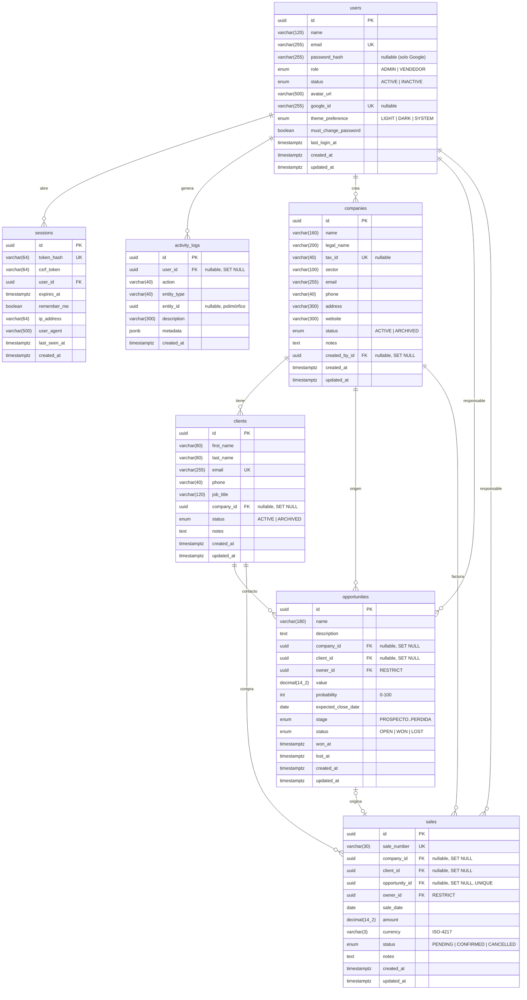

# Nexo CRM — Modelo de datos (ERD)

Fuente de verdad: [`backend/prisma/schema.prisma`](../backend/prisma/schema.prisma).
Motor: **PostgreSQL**. Los nombres de tabla y columna se mapean a `snake_case` con
`@@map` / `@map`.

## 1. Diagrama entidad‑relación



## 2. Enums

| Enum | Valores |
| --- | --- |
| `Role` | `ADMIN`, `VENDEDOR` |
| `UserStatus` | `ACTIVE`, `INACTIVE` |
| `ThemePreference` | `LIGHT`, `DARK`, `SYSTEM` |
| `CompanyStatus` | `ACTIVE`, `ARCHIVED` |
| `ClientStatus` | `ACTIVE`, `ARCHIVED` |
| `OpportunityStage` | `PROSPECTO`, `CALIFICACION`, `PROPUESTA`, `NEGOCIACION`, `GANADA`, `PERDIDA` |
| `OpportunityStatus` | `OPEN`, `WON`, `LOST` |
| `SaleStatus` | `PENDING`, `CONFIRMED`, `CANCELLED` |

## 3. Claves, restricciones e índices

### `users`

| Tipo | Definición |
| --- | --- |
| PK | `id` (uuid) |
| UNIQUE | `email`, `google_id` |
| NOT NULL | `name`, `email`, `role`, `status`, `theme_preference`, `must_change_password`, `created_at`, `updated_at` |
| Índices | `(role)`, `(status)` |

`password_hash` es opcional porque una cuenta puede existir solo con Google vinculado,
pero el sistema exige al menos un método de acceso (contraseña o `google_id`).

### `sessions`

| Tipo | Definición |
| --- | --- |
| PK | `id` |
| UNIQUE | `token_hash` |
| FK | `user_id → users.id` `ON DELETE CASCADE` |
| Índices | `(user_id)`, `(expires_at)` |

El token en claro nunca se almacena: solo el HMAC-SHA256. `csrf_token` es un valor
aleatorio por sesión; `remember_me` fija la expiración (8 h por defecto frente a 30 días).

### `activity_logs`

| Tipo | Definición |
| --- | --- |
| PK | `id` |
| FK | `user_id → users.id` `ON DELETE SET NULL` |
| Índices | `(entity_type, entity_id)`, `(created_at)`, `(user_id)` |

`entity_id` es polimórfico (no tiene FK) para permitir auditar entidades eliminadas.
`metadata` guarda datos puntuales (por ejemplo, el número de venta o el importe).

### `companies`

| Tipo | Definición |
| --- | --- |
| PK | `id` |
| UNIQUE | `tax_id` (NIT / identificación fiscal) |
| FK | `created_by_id → users.id` `ON DELETE SET NULL` |
| NOT NULL | `name`, `status`, `created_at`, `updated_at` |
| Índices | `(name)`, `(sector)`, `(status)` |

### `clients`

| Tipo | Definición |
| --- | --- |
| PK | `id` |
| UNIQUE | `email` |
| FK | `company_id → companies.id` `ON DELETE SET NULL` |
| NOT NULL | `first_name`, `last_name`, `email`, `status`, `created_at`, `updated_at` |
| Índices | `(last_name, first_name)`, `(company_id)`, `(status)` |

Un cliente puede existir sin empresa (contacto independiente); si la empresa se eliminara
por mantenimiento, el contacto se conserva. La API no permite borrar empresas/clientes
con actividad: solo archivarlas.

### `opportunities`

| Tipo | Definición |
| --- | --- |
| PK | `id` |
| FK | `company_id → companies.id` `SET NULL`; `client_id → clients.id` `SET NULL`; `owner_id → users.id` `RESTRICT` |
| NOT NULL | `name`, `owner_id`, `value`, `probability`, `stage`, `status`, `created_at`, `updated_at` |
| CHECK (aplicado en servicio) | `value > 0`; `0 <= probability <= 100` |
| Índices | `(stage)`, `(status)`, `(owner_id)`, `(company_id)`, `(client_id)`, `(expected_close_date)` |

`ON DELETE RESTRICT` en `owner_id` impide eliminar usuarios con oportunidades asignadas
(se desactivan en su lugar). `won_at`/`lost_at` se completan al pasar a `GANADA`/`PERDIDA`
y se limpian al reabrir la oportunidad.

### `sales`

| Tipo | Definición |
| --- | --- |
| PK | `id` |
| UNIQUE | `sale_number`, `opportunity_id` (una oportunidad ⇒ como máximo una venta) |
| FK | `company_id`/`client_id` `SET NULL`; `opportunity_id` `SET NULL`; `owner_id → users.id` `RESTRICT` |
| NOT NULL | `sale_number`, `owner_id`, `sale_date`, `amount`, `currency`, `status`, `created_at`, `updated_at` |
| CHECK (aplicado en servicio) | `amount > 0`; `currency` ISO de 3 letras |
| Índices | `(status)`, `(sale_date)`, `(owner_id)`, `(client_id)`, `(company_id)` |

La numeración se genera con la secuencia PostgreSQL creada en la migración
`20261029174000_add_sale_number_sequence`:

```sql
CREATE SEQUENCE IF NOT EXISTS sale_number_seq START 1;

-- Por cada venta nueva (dentro de la misma transacción):
SELECT nextval('sale_number_seq');
-- sale_number = 'V-' || año || '-' || lpad(valor, 5, '0')
```

## 4. Reglas de borrado y ciclo de vida

| Entidad | Borrado físico | Alternativa |
| --- | --- | --- |
| `users` | Solo si no tiene oportunidades/ventas (RESTRICT) | `status = INACTIVE` |
| `sessions` | Sí (al cerrar sesión, revocar o expirar) | — |
| `activity_logs` | No se eliminan por API | — |
| `companies` | Bloqueado por API | `status = ARCHIVED` |
| `clients` | Bloqueado por API | `status = ARCHIVED` |
| `opportunities` | Solo si no tiene venta asociada | `stage = PERDIDA` |
| `sales` | Bloqueado por API | `status = CANCELLED` |

## 5. Migraciones

| Migración | Contenido |
| --- | --- |
| `20261029173755_init` | Enums, 6 tablas, llaves, únicos, índices y relaciones con sus políticas de borrado. |
| `20261029174000_add_sale_number_sequence` | Secuencia `sale_number_seq` para numerar ventas de forma atómica. |

Comandos:

```bash
pnpm db:migrate    # desarrollo (crea migración si cambia el esquema)
pnpm db:deploy     # aplica migraciones existentes (CI/producción)
```

> El ERD anterior muestra tipos lógicos. En PostgreSQL, los `DateTime` de Prisma se
> materializan como `timestamp(3)` y las fechas civiles (`expected_close_date`,
> `sale_date`) como `date`.
